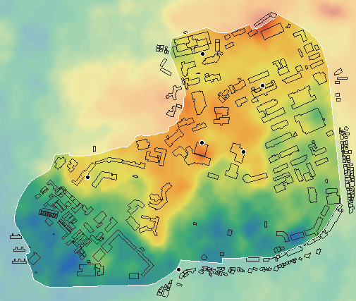
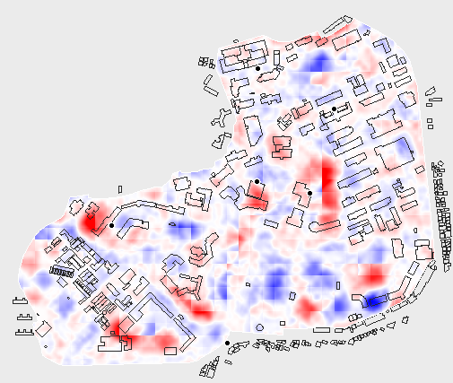

# 공공데이터로 지형·건물 높이·조경 보강 조사

조사만 했고 게임 코드(assets/)는 고치지 않았다. 발표용 상태는 main의 태그 `v1-presentation`.

| 스크립트 (Python 표준 라이브러리만) | 하는 일 |
|---|---|
| `scripts/fetch_terrain.py` | AWS Terrain Tiles(terrarium PNG, 키 없음) z15 타일 9장을 `data/raw/terrain/`에 저장 (커밋 안 함) |
| `scripts/terrain_report.py` | 높이 분석 + `docs/terrain-height.png`, `docs/terrain-diff.png` |
| `scripts/fetch_vworld.py` | 브이월드 건물통합정보(LT_C_SPBD) 지상층수를 `data/raw/vworld_buildings.json`에 저장 (키는 `.env`, 커밋 안 함) |
| `scripts/building_floors.py` | 브이월드·OSM 층수를 짝지어 `data/building-floors.csv`와 `campus.json` 높이에 반영 |
| `scripts/survey_landscape.py` | Overpass로 캠퍼스 안 조경 요소 개수 |

## 1. 지형 높이 (AWS Terrain Tiles, terrarium z15)

- 캠퍼스 범위(경계 + 150m)는 z15 타일 x 27934~27936, y 12958~12960 (3×3장). 타일 한 칸은 약 4m지만, 지면이 매끄럽고 건물이 보이지 않아 원자료는 더 거친 것으로 보인다.
- **캠퍼스 안 최저 27.8m(남서쪽 끝, 생활관 쪽 아래), 최고 65.8m(북동쪽 끝), 차이 38m.** 가운데(중앙도서관)에서 북동쪽으로 높은 등성이가 있고 남서쪽으로 낮아진다.

| 장소 | 게임 좌표 (x, z) | 높이 (m) | 건물 중심 높이 (m) |
|---|---|---|---|
| 정문 | (3, 505) | 36.6 | - |
| 농생대 1호관 (미션 지점) | (-383, 112) | 48.0 | 48.9 |
| 중앙도서관 (미션 지점) | (100, -34) | 54.1 | 58.9 |
| 제1학생회관 (미션 지점) | (279, 5) | 51.9 | 51.1 |
| 생활관 9호관 (미션 지점) | (106, -413) | 47.4 | 48.0 |
| 공과대 2호관 (도착) | (360, -276) | 49.2 | 48.9 |

정문에서 공과대 2호관까지 약 13m 오르막. 중앙도서관이 가장 높다.

- **국토지리정보원 DEM(2025, 도엽 35616) 비교:** 해상도 90m(261×316칸), 좌표계 KGD2002 / UTM-K(EPSG:5179, GRS80 횡메르카토르). 캠퍼스 안 30m 간격 1,108점에서 AWS보다 평균 3.0m 낮고(평균 절대차 3.3m), 범위 29.6~53.6m(AWS 28.2~64.2m)로 언덕 꼭대기가 뭉개진다(정문 33.8m, 미션 지점 43.4~50.7m) → 게임에는 더 촘촘한 AWS 지형을 쓴다.

*높이 지도: 파랑(26m) → 초록 → 노랑 → 빨강(68m). 검은 선 = OSM 건물, 흰 선 = 캠퍼스 경계, 점 = 정문·미션 지점. 1픽셀 = 3m.*

### 건물·나무가 섞인 표면 높이인가? → 아니다 (지면 높이에 가깝다)

OSM 도로(차도+보행로) 위 점 8,210개만으로 지면을 만들고(가까운 도로 점들의 거리 가중 평균), 같은 자리의 타일 높이와 10m 간격 9,996점에서 비교했다.

| 비교 | 값 |
|---|---|
| 평균 차이 (타일 − 도로 기반 지면) | +0.05m |
| 평균 절대 차이 | 0.76m |
| 차이가 3m를 넘는 비율 | 3.6% |
| 최대 / 최소 | +7.6m (-447, 109) / -6.0m (483, 369) |
| 건물 중심 210곳 평균 | **+0.05m** (건물 높이 14m가 섞였다면 +10m 이상이어야 함) |
| 숲 중심 183곳 평균 | **+0.03m** (나무 높이가 섞였다면 + 몇 m) |

→ 건물·나무 높이는 섞여 있지 않다. 남은 차이는 도로가 없는 언덕 꼭대기·비탈(도로 기반 지면이 언덕을 낮게 잡음)에서 생긴 것이다.

*차이 지도: 빨강 = 타일이 도로 기반 지면보다 높음, 파랑 = 낮음 (±6m에서 진한 색).*

경사: 캠퍼스 안 20m 간격 경사 중앙값 6.8%, 상위 10% 14%, 최대 28%. **차도 구간은 중앙값 3.1%, 최대 17%**로 완만하다. 건물 하나의 외곽선 안 높이 차는 중앙값 1.5m지만 G&R허브 10.8m, 치전원 1호관 8.4m, 사회과학대학 7.9m, 중앙도서관 7.8m처럼 큰 곳이 있다.

## 2. 건물 높이

**반영 결과 (브이월드 키 받은 뒤):** 브이월드 건물 2,896동(층수 있는 2,469동)을 받아 OSM 건물 안에 점을 고르게 찍어 겹치는 면적으로 짝지었다(겹침 30% 이상). 캠퍼스 안 210동 → 브이월드 90, OSM 38, 층수 없음(기본 4층) 82. 높이 = 층수 × 4m + 옥상 난간 1m.

- 브이월드에서 이름이 "전남대학교"인 123동 중 122동이 모두 4층이다(단지 대표값으로 보임). 이 값이 진리관 9층·교육융합관 10층 같은 OSM 값을 덮지 않도록, 같은 이름 20동 이상이 95% 넘게 같은 층수면 OSM 다음으로 미뤘다(17동).
- csv의 층수 칸을 고치고 `python scripts/building_floors.py`(또는 `build_map.py`)를 다시 돌리면 출처가 "직접"으로 바뀌고 campus.json에 반영된다.
- 미션 건물: 농생대 1호관 4층(OSM), 중앙도서관 5층(OSM), 제1학생마루 4층(브이월드), 생활관 9C동 4층(브이월드), 공과대 2호관 4층(브이월드).

아래는 브이월드 키를 받기 전 조사 내용.

| 범위 | 건물 수 | OSM 층수 있음 | 기본값 14m |
|---|---|---|---|
| 캠퍼스 경계 + 50m (게임 전체) | 352 | 95 | 257 |
| 캠퍼스 안 | 210 | **45** | **165** |

(높이 태그만 있고 층수가 없는 건물은 0동. 높이 태그가 있는 17동은 모두 층수도 있다.)

- **브이월드: `.env` 파일이 없어 `VWORLD_KEY`가 없다.** 브이월드(vworld.kr) 인증키가 있어야 지상층수를 받을 수 있다. 키를 받으면 `.env`에 `VWORLD_KEY=...`로 넣어 주면 된다 (`.env`는 `.gitignore`에 추가했고, 키는 코드·커밋에 넣지 않는다). 그때 건물통합정보의 지상층수를 받아 OSM 건물과 위치로 짝짓는 단계를 추가할 수 있다.
- **`data/building-floors.csv`** (210행, 엑셀에서 한글이 보이도록 UTF-8 BOM): `건물 이름, 지금 높이(m), 층수, 출처, osm_id, 바닥면적(m2)`. 층수는 OSM에 있을 때만 채우고(출처 OSM), 없으면 비워 두었다(출처 없음). 맨 위에 미션 장소 5곳, 그다음 바닥 면적이 큰 순서. `osm_id`는 나중에 게임 데이터에 다시 합칠 때 쓴다.
  - 미션 5곳 중 층수가 없는 곳: 제1학생마루(제1학생회관), 생활관 9C동, 공과대 2호관.

## 3. 조경 디테일 (OSM, 캠퍼스 경계 안)

| 항목 | 개수 | 세부 |
|---|---|---|
| 연못·물 | 12 | 이름 있는 것은 "용지" (나머지는 물길·저수 시설 등) |
| 개별 나무 (natural=tree) | 1 | 사실상 없음 → 지금처럼 녹지·도로를 따라 심는 방식 유지 |
| 가로수 (tree_row) | 4 | |
| 주차장 | 185 | 작은 주차 구획이 많음 |
| 운동장·체육 시설 | 26 | 테니스 6, 농구 6, 종류 없음 3, 풋살 2, 스포츠센터 2, 다목적·육상 1, 다목적 1, 육상 트랙 1, 배구 1, 축구 1, 놀이터 1, 야구 1 |
| 벤치·피크닉 테이블 | 26 | |
| 가로등 | 0 | |
| 담장·울타리 | 0 | |
| 계단 | 37 | |
| 보행로 | 691 | footway 638, path 39, pedestrian 14 |
| 버스정류장 | 4 | |
| 자전거 보관소 | 18 | |
| 조형물·기념물 | 26 | 용봉탑, 5.18사적비, 윤상원 열사 흉상, 김남주 시비, 광주민중항쟁도, 석장승 2, 노벨 흉상 등 |

→ 넣을 만한 것: 주차장 바닥(185), 벤치(26), 조형물 위치(26, 작은 받침대+기둥 정도), 운동장 종류별 색·라인, 버스정류장(4). 가로등·울타리·개별 나무는 OSM에 없어 공공데이터로는 보강이 안 된다.

## 4. 지형을 게임에 넣으려면

**고쳐야 하는 파일**

| 파일 | 할 일 |
|---|---|
| `scripts/build_map.py` (또는 새 `build_terrain.py`) | 높이 격자(예: 10m 간격, 약 150×130칸)를 `data/terrain.json`으로 굽기. 건물마다 바닥 높이(외곽선 아래 최저) 기록 |
| `assets/js/map.js` | 평평한 바닥 → 높이를 준 격자 메시. 캠퍼스 바닥·녹지·도로·차선 점선을 지형에 얹기(정점마다 높이, 긴 도로 구간은 잘게 나눔). 건물을 바닥 높이에서 세우고 벽을 땅속까지 내림. 나무·정문 y |
| `assets/js/car.js` | 굴착기 y = 지면 높이, 경사에 따라 앞뒤·좌우 기울기(선택: 오르막 감속). 충돌(2D)은 그대로 |
| `assets/js/camera.js` | 따라가기·운전석 카메라 높이를 지면 기준으로, 카메라가 언덕 속으로 들어가지 않게 최소 높이 |
| `assets/js/late-mode.js` | 미션 원·빛 기둥·이모지, 교수님 위치, 연출 카메라 위치 y |
| `assets/js/hud.js` | 이름표 높이(건물 바닥 + 높이). 미니맵에 음영(선택) |
| `assets/js/main.js` | 지형 데이터 불러오기, 시작 화면 카메라 높이 |

**예상 시간:** 4~6시간 (지형 메시와 바닥 층 얹기 2h, 굴착기·카메라 1h, 건물·나무·표시물·교수님 1h, 확인·성능·연출 점검 1~2h).

**위험한 부분**

1. **바닥 층 그리기 방식이 깨진다 (가장 큼).** 지금은 바닥·녹지·도로를 깊이를 쓰지 않고 그리는 순서로 겹쳐서 깜빡임을 막는다. 언덕이 생기면 앞 언덕이 뒤쪽 도로를 가리지 못해 도로가 언덕을 뚫고 보인다. 깊이를 쓰면서 층마다 살짝 띄우는(polygonOffset) 방식으로 바꿔야 하고, 그때 깜빡임이 다시 생기지 않는지 꼼꼼히 봐야 한다.
2. **건물이 뜨거나 묻힘.** 외곽선 안 높이 차가 큰 건물(G&R허브 10.8m 등)은 한쪽이 떠 보인다 → 벽을 바닥 최저보다 더 내려야 한다.
3. **연출 카메라·미니맵·미션 원.** 정해 둔 높이(정문 굴착기 돌기, 공대 2호관 앞 교수님)가 언덕에 묻히거나 미션 원이 비탈에 파묻힐 수 있다.
4. **원자료 해상도.** 매끄러운 지형이라 계단·옹벽 같은 급한 높이 차는 표현되지 않는다(게임에는 오히려 무난).
5. **출처 표기.** 넣는다면 크레딧에 Terrain Tiles(AWS Open Data)와 원자료 출처를 적어야 한다.
6. **일정.** 발표 직전이라 main은 그대로 두고 terrain 브랜치에서만 진행하는 것이 안전하다.
