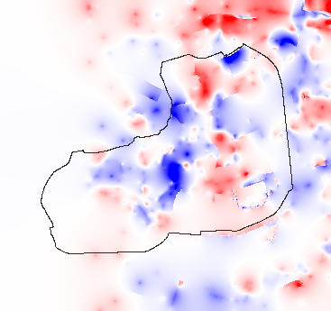

# 지형: 국토지리정보원 수치지도로 다시 만들기

`scripts/build_terrain_ngii.py` → `data/terrain.json` (5m 격자 367×345). 바탕은 AWS Terrain Tiles(약 30m 정밀도), 그 위에 수치지도와의 차이(보정량)를 매끄럽게 퍼뜨려 더한다.

| 자료 | 쓴 것 |
|---|---|
| 2020 1:1,000 (정문~공대 구역, x 16~927 · z −344~769) | 등고선(1m 간격) 239개, 표고점 12개, 옹벽·석축 173개, 제방 11개 — 이 구역에선 이것만 씀 |
| 2025 1:5,000 (그 밖, x −441 동쪽) | 등고선(5m 간격), 표고점, 옹벽·석축·제방, 절토·성토(법면) 선 |
| AWS Terrain Tiles | 수치지도가 없는 캠퍼스 서쪽 끝·바깥: 보정량이 수치지도 구역의 평균 보정량(−4.4m)으로 서서히 이어짐 |

풀이: 거친 격자 20m → 10m → 5m 가우스-자이델. 조건은 등고선 점 8180개, 표고점 110개, 옹벽 위아래 높이 차 1271곳. 옹벽·석축·제방·법면 선 559개를 지나는 격자 이음은 매끄러움 조건을 끊어 단차가 남게 함.

## 검증 (지형 만들 때 쓰지 않은 측량값과 비교)

표고점 96개 (무작위 20% + 2020 구역 안의 2025 표고점 전부), 등고선 선 단위 10% (2327점).

| 기준 | AWS (이전) | 수치지도 (새) |
|---|---|---|
| 표고점 평균 차 | +3.69m | -0.52m |
| 표고점 평균 절대 오차 | 3.91m | **1.34m** |
| 표고점 RMS | 4.44m | 1.83m |
| 표고점 최대 오차 | 9.19m | 6.90m |
| 떼어 둔 등고선 점 평균 절대 오차 | 4.01m | **1.67m** |
| 떼어 둔 등고선 점 최대 오차 | 12.46m | 5.66m |

→ 새 지형이 모든 기준에서 나아 채택. AWS는 전체적으로 약 3~4m 높게 잡혀 있었음(이전 조사의 국토지리정보원 DEM 비교와 같은 방향).

## 옹벽·석축 단차 확인 (높이 2m 이상, 서로 35m 넘게 떨어진 12곳)

정사영상 조각(`ref/terrain-steps.png`, 커밋 안 함)에서 12곳 모두 옹벽·석축·연못 둑·테니스장 단 같은 단차가 보임. 위아래 4m 떨어진 두 점의 높이 차:

| # | 위치 (x, z) | 옹벽 높이(수치지도) | 새 지형 위아래 차 | AWS 위아래 차 |
|---|---|---|---|---|
| 1 | (30, -186) | 5.0m | 4.55m | -0.50m |
| 2 | (575, 239) | 4.0m | 4.64m | 0.14m |
| 3 | (71, -250) | 2.5m | 2.85m | 0.31m |
| 4 | (36, -248) | 2.5m | 2.67m | -0.72m |
| 5 | (377, 244) | 2.0m | 2.24m | 0.36m |
| 6 | (385, 280) | 2.0m | 2.24m | 0.42m |
| 7 | (398, 316) | 2.0m | 2.41m | 0.46m |
| 8 | (434, 321) | 2.0m | 1.60m | 0.15m |
| 9 | (469, 323) | 2.0m | 0.18m | 0.82m |
| 10 | (504, 313) | 2.0m | 3.26m | 0.04m |
| 11 | (537, 300) | 2.0m | 2.33m | 0.72m |
| 12 | (532, 139) | 2.0m | 2.28m | 0.57m |

12곳 중 11곳은 새 지형에 실제 높이에 가까운 단차(1.6~4.6m)가 생김. 9번(469, 323)은 근처 등고선·표고점이 위아래를 잘 잡아 주지 못해 단차가 0.2m만 남음. AWS는 모두 0.8m 이하(단차 없음).

## 차이 지도

*정문 앞 출발점을 0으로 맞춘 상대 높이끼리의 차이(게임에서 보이는 차이). 빨강 = 새 지형이 높음, 파랑 = 낮음(±6m에서 진한 색). 1칸 = 5m, 검은 선 = 캠퍼스 경계.*

### 차이가 3m 이상인 곳 (캠퍼스 안, 넓은 순 20곳)

| 가운데 (x, z) | 넓이 | 최대 차 |
|---|---|---|
| (29, 150) | 20750m² | -9.9m |
| (201, -362) | 8700m² | +5.8m |
| (62, -208) | 8500m² | -8.6m |
| (367, -505) | 5975m² | -10.6m |
| (106, 25) | 2350m² | -8.0m |
| (294, -58) | 1875m² | +5.0m |
| (290, -254) | 800m² | -3.7m |
| (294, 234) | 800m² | +4.4m |
| (434, 137) | 675m² | +6.9m |
| (339, 177) | 600m² | +3.6m |
| (286, -129) | 575m² | -4.3m |
| (283, 90) | 525m² | +5.0m |
| (365, 0) | 425m² | +4.0m |
| (278, 194) | 400m² | +3.5m |
| (-308, 149) | 225m² | -4.7m |
| (278, -159) | 175m² | -3.2m |
| (456, 198) | 150m² | -3.9m |
| (246, 181) | 125m² | +3.2m |

## 게임에서

- 건물·나무·소품·미션 원·교수님·연출 카메라는 그대로 지형을 따름. 뜬 건물 0, 묻힌 미션 원 0, 시작 연출 카메라 땅 위 최소 2.0m.
- 차도 메시: 지형이 급히 꺾이는 곳은 1m 간격으로 잘게 나누고, 점마다 둘레 0.6m 안 가장 높은 땅 위에 얹음 → 땅이 도로를 뚫는 곳 0.002%(최대 13cm). 카메라 1cm 이동 비교로 깜빡임 없음.
- 굴착기: 옹벽 자리의 짧고 가파른 단차(차도 위 경사 25% 넘는 곳 41군데, 최대 88%)에서 튀지 않게 높이는 부드럽게 따라가고(땅속 최대 0.25m), 기울기는 18°, 속도 계산 경사는 25%까지만 씀. 지형 모양은 그대로.
